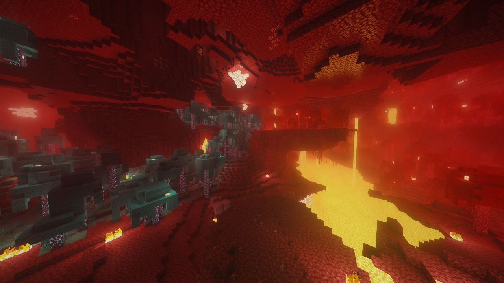
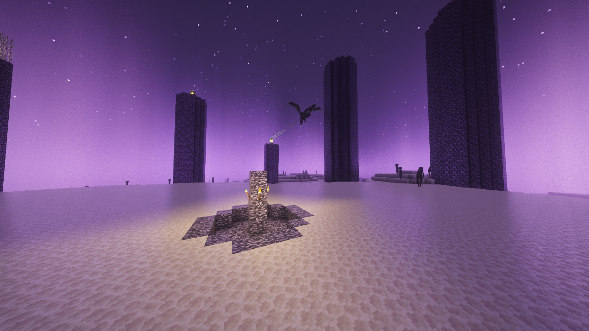
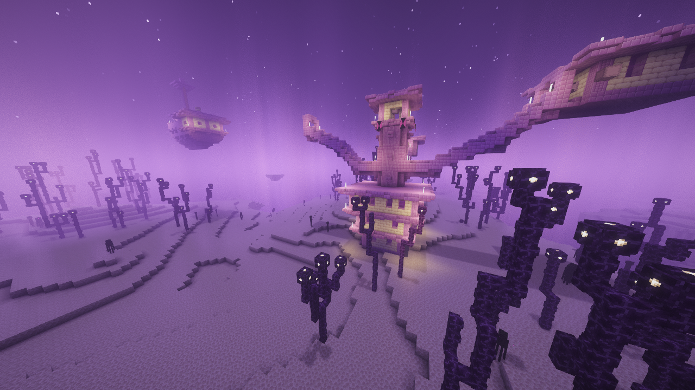
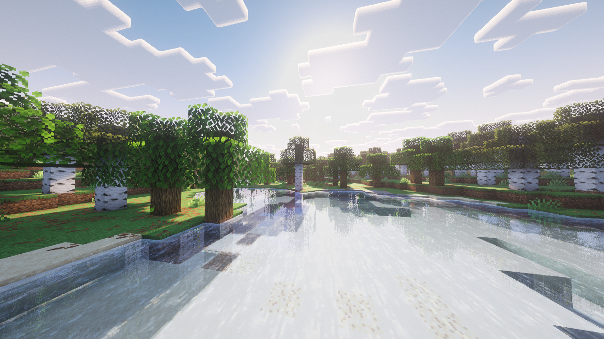
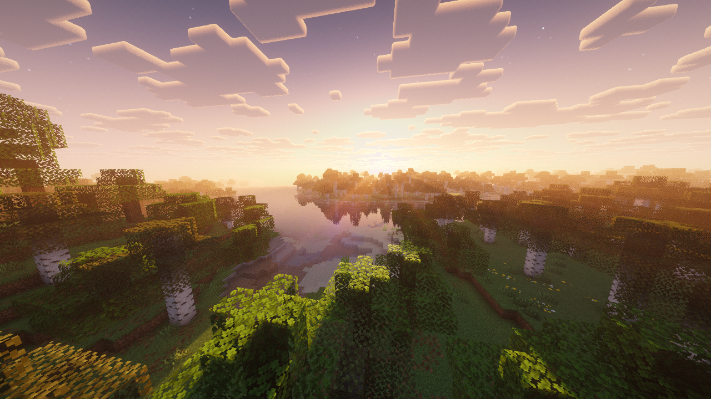
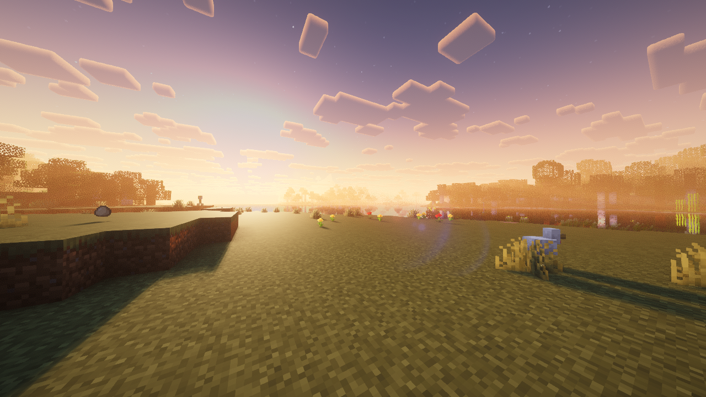
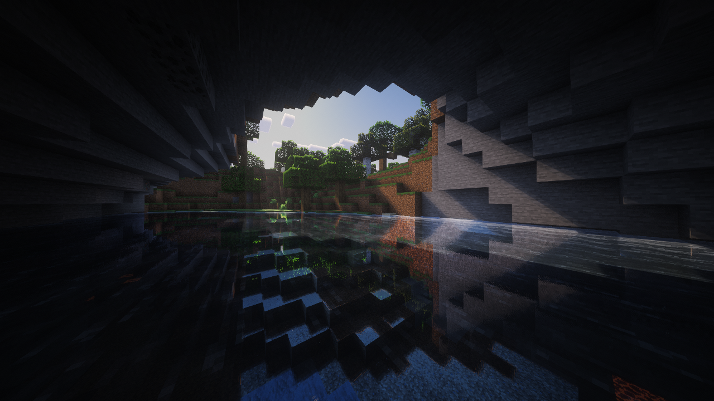
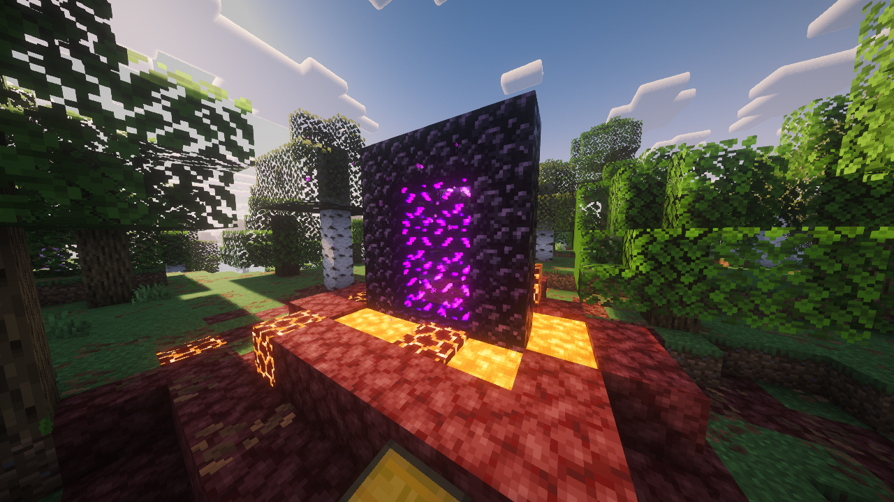
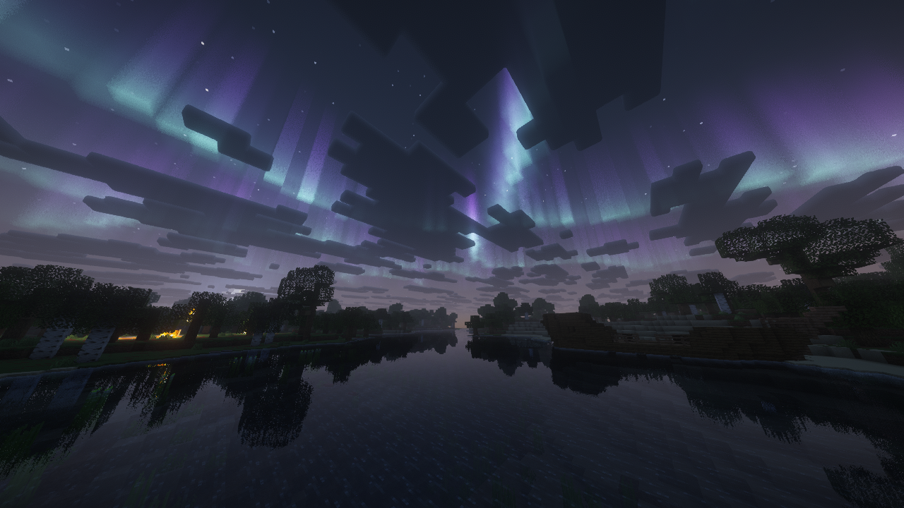
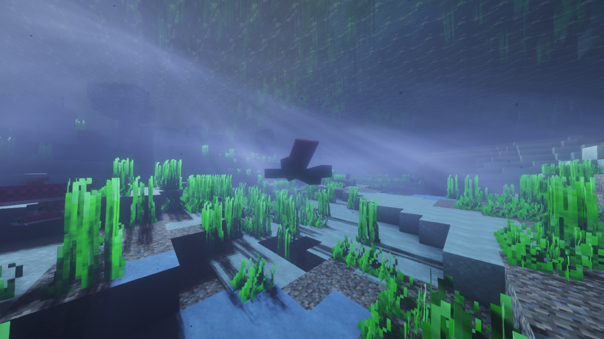

# Aurora

A shader pack for Horizon, written against Horizon's native shader API 0.1. Aurora brings a full
desktop-style shader pipeline to Horizon: real-time shadows, volumetric light shafts, water,
clouds, lens flare and HDR emissive lighting. Its GLSL source is translated to WGSL, with adapters
that emulate the Iris pipeline inside Horizon.

For personal use. See LICENSE.txt.

## What's here

| Path | What it is |
| --- | --- |
| `aurora.hshader` | The built pack (drop into `%APPDATA%\horizon\shaderpacks`). |
| `aurora-src.tar.gz` | The whole source tree below, with its folders (the web upload flattens folders). |
| `source/shaders` | The GLSL shader source, with the Horizon-specific edits marked `HZ_PORT` / "Horizon port". |
| `crport/` | The translator: GLSL (preprocessed with Iris's defines) → SPIR-V (glslang) → WGSL (naga), then the Horizon adapters and generators. |
| `crport/adapter/` | WGSL emulating Iris for the post passes and the material stage (depth, shadow maps, shadowcolor1, colortex6/4, HDR scale). |
| `opts/` | The settings: which shader options become Horizon `[[options]]` (WGSL `override`s), their ranges, and the full build script. |
| `harness/` | The equivalence tests: the GLSL run on OpenGL (moderngl) against the translated WGSL on wgpu, pass by pass. |
| `tools/hzcheck.py` | A local copy of Horizon's pack check (limits, expression counts). |

## Features

- Runtime settings (Horizon compiles a pack once, so options are WGSL `override`s): Profile (light
  shafts, FXAA, cloud quality), Shadow Distance, Lens Flare (on by default), Aurora Condition,
  Emissive Brightness, Portal Glow.
- Light-emitting blocks keep their HDR brightness through Horizon's 0..1 picture (scale stored in the surface data).
- Enderman eyes and chorus plant light spots glow.
- Underwater light shafts with water noise computed in the post passes.
- Light shafts averaged over two dithers from the High profile up, for a clean result without TAA.
- Nether biome colours recovered from the fog colour (Horizon gives no biome).
- Softer Nether storm (0.36) and Nether/End border fog (0.90).

## Screenshots

