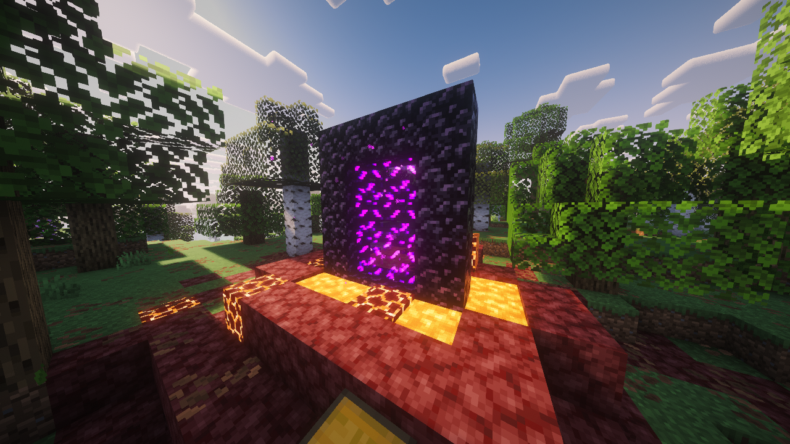
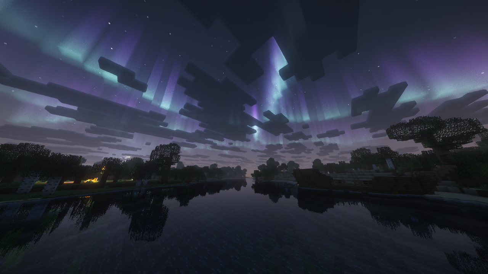
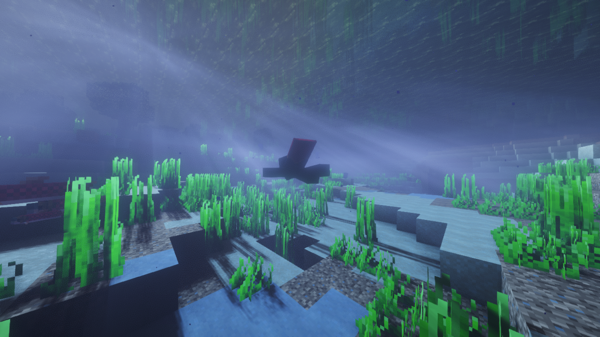
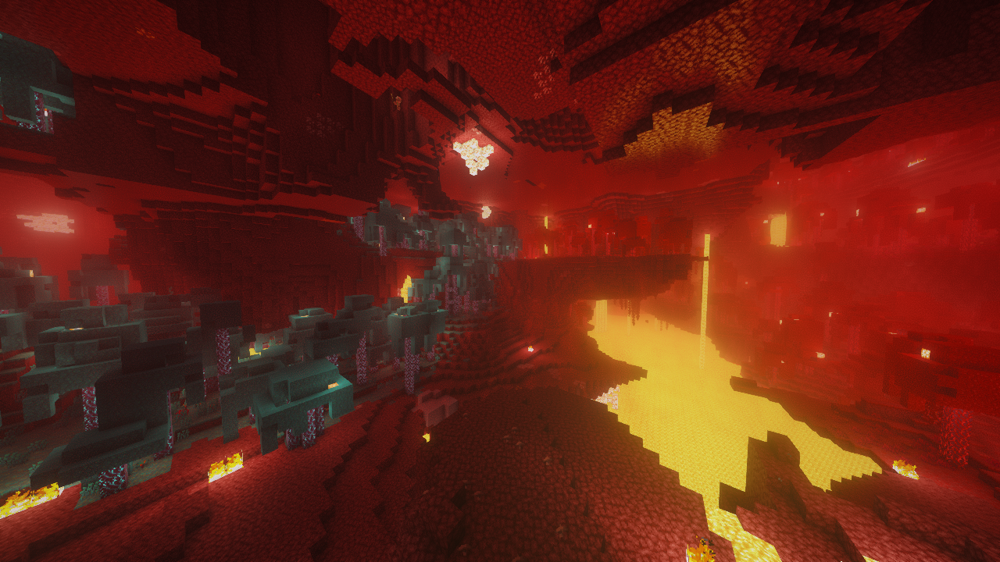
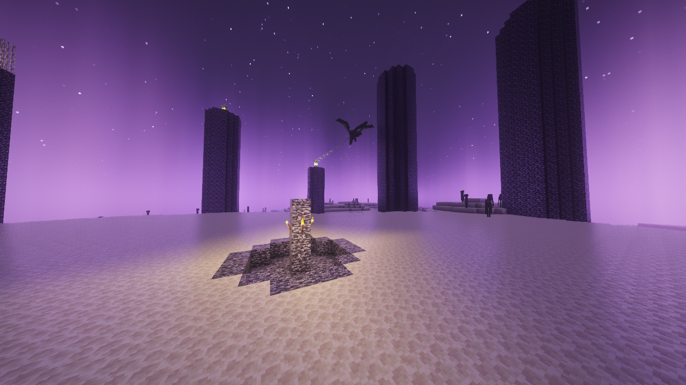
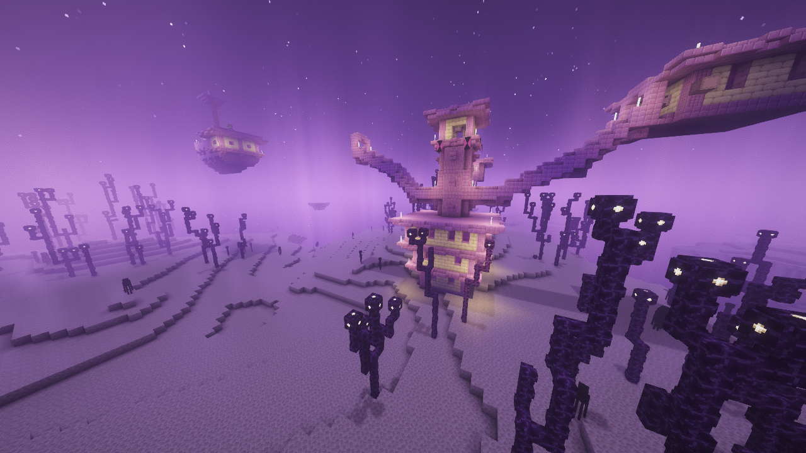
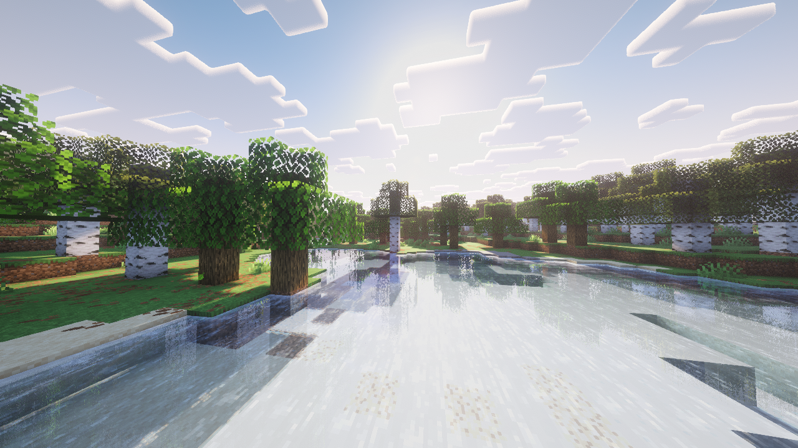
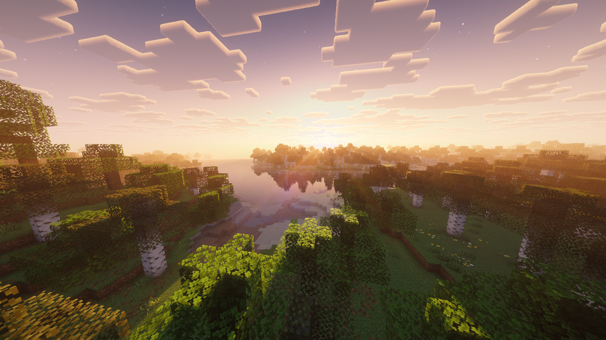
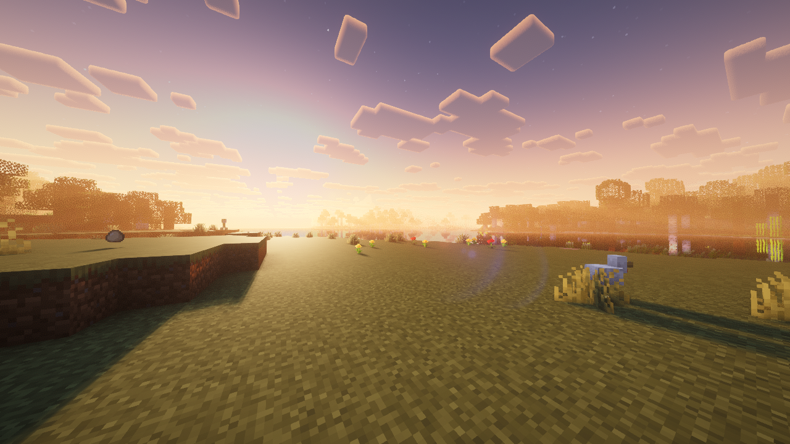
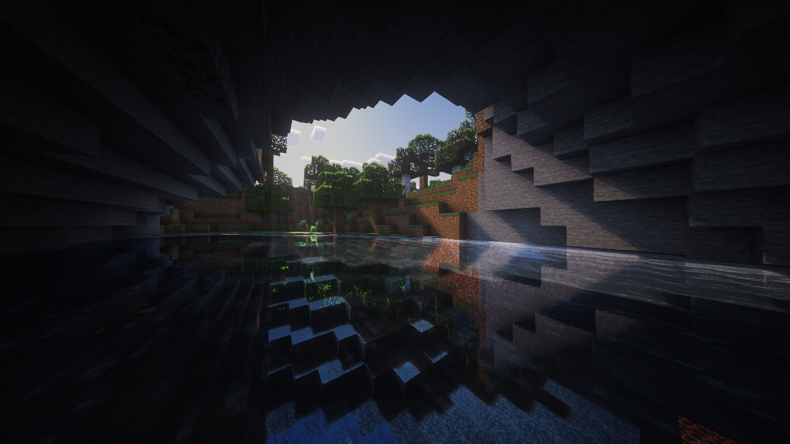

# Aurora

A shader pack for Horizon, written against Horizon's native shader API 0.1. Aurora brings a full
desktop-style shader pipeline to Horizon: real-time shadows, volumetric light shafts, water,
clouds, lens flare and HDR emissive lighting. Its GLSL source is translated to WGSL, with adapters
that emulate the Iris pipeline inside Horizon.

## Screenshots

